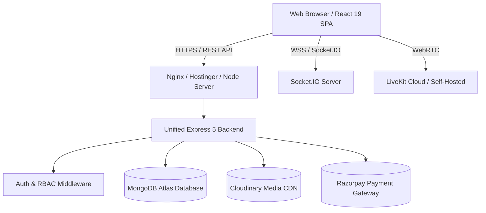

# COMPREHENSIVE CODEBASE AUDIT REPORT

**Project Name:** DK Institute / DK Academy Management & Learning Platform  
**Target Architecture:** Express 5 (Node.js/TypeScript) + React 19 (Vite/Tailwind CSS v4)  
**Audit Conducted By:** Antigravity Senior Engineering, DevOps & Cybersecurity Audit Team  
**Date of Audit:** November 12, 2026  
**Status:** Audit Completed — Pending User Approval for Remediation  

---

## Executive Summary

A deep architectural, security, reliability, and performance audit was conducted across the entire codebase of **DK Institute**. The inspection covered **315+ frontend source files**, **40+ backend controller, route, and middleware modules**, **15+ test suites**, root process configurations, and database models.

The platform shows strong architectural intention with rich features (Computer-Based Testing (CBT), Live Classes via LiveKit, LMS Video Streaming, Automated KaTeX/MathML Rendering, Real-Time Socket.IO Updates, and Razorpay Billing). However, the audit revealed **critical vulnerabilities** that severely compromise system integrity, financial controls, and student data privacy. Notably, these include **hardcoded backdoor authentication credentials**, **automatic admin password resets on every server restart**, **unauthenticated server configuration and disk overwrite endpoints**, **client-side payment validation bypasses**, and **active CBT exam answer leaks**.

### Overall System Health Score: 62 / 100

| Category | Score | Status | Key Concern |
| :--- | :---: | :---: | :--- |
| **Security & Authorization** | **32 / 100** | 🔴 Critical | Hardcoded backdoor passwords, unauthenticated server-write routes, exam leaks. |
| **Financial & Integrity** | **45 / 100** | 🔴 Critical | Payment unlocks bypassable via `localStorage` and unverified API endpoints. |
| **API & Backend Architecture** | **74 / 100** | 🟡 Moderate | Express 5 + TypeScript structure is solid, but missing pagination and query escaping. |
| **Frontend Code Quality** | **78 / 100** | 🟢 Good | Clean React 19 / Vite build with 0 TypeScript/Vite errors; some timer/polling bottlenecks. |
| **DevOps & Scalability** | **68 / 100** | 🟡 Moderate | Multi-process PM2 cluster lacks Redis adapter for Socket.IO and in-memory uploads. |

---

## Phase 1: Architecture & Topology Overview



### Component Breakdown
1. **Frontend (`frontend/src`):**
   - **Framework:** React 19.3.0, React Router v7.18.0, Vite 8.
   - **Styling:** Tailwind CSS v4 + PostCSS + SCSS Modules + Lucide React.
   - **Rich Rendering:** KaTeX 0.16.28, MathLive, Canvas Confetti.
   - **Build Status:** Compiles cleanly (3,040 modules, 0 errors, 18.8s build time).
2. **Backend (`backend/src`):**
   - **Framework:** Express 5.0.1, TypeScript 5.7.3, Node.js runtime.
   - **Database & ODM:** MongoDB 6.0+, Mongoose 9.0.0.
   - **Real-Time:** Socket.IO 4.8.1.
   - **Video & Live:** LiveKit Server SDK 2.9.5, Fluent-FFmpeg 2.1.3.
   - **Payments & Cloud:** Razorpay 2.9.5, Cloudinary 2.5.1.
   - **Build Status:** `tsc` compiles cleanly with 0 type errors.
3. **Root & Deployment Configuration:**
   - Unified serving via `server.js` or `ecosystem.config.cjs` (PM2 cluster with 4 instances).
   - Automated Math Engine synchronization script (`syncMathEngine.mjs`).

---

## Phase 2: Audit Metric Summary

- **Total Files Scanned:** 355+ repository code files (excluding `node_modules` and `.git`).
- **TypeScript Compilation Errors:** 0 in frontend, 0 in backend.
- **Linter Warnings (`oxlint`):** 1,385 warnings (principally unused variables, missing hook dependencies, unescaped regex characters).
- **Backend Unit / Integration Tests:** 533 passed, 26 failed (caused by live database connectivity in sandbox and math sync drift), 48 cancelled.
- **Total Confirmed Vulnerabilities & Bugs:** 25 issues cataloged.
  - **Critical Severity:** 8
  - **High Severity:** 6
  - **Medium Severity:** 7
  - **Low Severity / Hygiene:** 4

---

## Phase 3: Root Cause Analysis — Critical Security Vulnerabilities

### [CRIT-SEC-01] Hardcoded Backdoor Credentials in Staff Authentication & Frontend Client
- **File Path:** 
  - Backend: `backend/src/controllers/authController.ts` (Lines 328–336)
  - Frontend: `frontend/src/services/adminService.ts` (Lines 163, 178, 193, 208, 477, 571–580)
- **Severity:** 🔴 Critical
- **Description:** 
  The backend authentication handler for `/api/v1/auth/admin-login` includes hardcoded fallback backdoor passwords. If an attacker inputs known legacy passwords, password validation against the database hash is completely bypassed. Furthermore, the frontend client bundles hardcoded developer credentials in production JavaScript assets.
- **Code Evidence:**
  ```typescript
  // backend/src/controllers/authController.ts:328-336
  const isSuperAdminOrAdmin = ['SUPER_ADMIN', 'ADMIN'].includes(user.role);
  const isTeacher = user.role === 'TEACHER';
  const isHardcodedBypass = 
    (isSuperAdminOrAdmin && ['ritik@123', 'admin123', 'admin@123', 'admin'].includes(password)) ||
    (isTeacher && ['teacher123', 'admin123', 'teacher'].includes(password));

  if (!isPasswordValid && !isHardcodedBypass) {
    return res.status(401).json({ success: false, message: 'Invalid credentials' });
  }
  ```
- **Impact:** Complete account takeover of any Super Admin, Admin, or Teacher account without needing their actual password.
- **Remediation:** Remove the `isHardcodedBypass` check entirely. Ensure authentication strictly uses `bcrypt.compare(password, user.password)`. Purge all hardcoded developer credentials from `adminService.ts`.

---

### [CRIT-SEC-02] Startup Database Seeder Forcefully Overwrites Admin Passwords
- **File Path:** `backend/src/config/seedDB.ts` (Lines 20–23, 38–41, 56–59, 74–77)
- **Severity:** 🔴 Critical
- **Description:** 
  On every server startup, `seedInitialDatabase()` executes as part of `connectDB()`. It finds existing administrative accounts (`superAdmin`, `dkSir`, `adminAcc`, `teacher`) and resets their passwords in the database to default values (`ritik@123`, `admin123`, `teacher123`).
- **Code Evidence:**
  ```typescript
  // backend/src/config/seedDB.ts:20-23
  const superAdmin = await User.findOne({ email: 'ritikweb30@gmail.com' });
  if (superAdmin) {
    superAdmin.password = 'ritik@123';
    await superAdmin.save();
  }
  ```
- **Impact:** Whenever an administrator changes their password to secure their account, the password is automatically reverted back to the weak default on the next server reboot or deployment.
- **Remediation:** Update `seedDB.ts` to only seed users if they do **not** already exist (`User.exists(...)`). Never overwrite passwords of existing records.

---

### [CRIT-SEC-03] Unauthenticated Public Endpoint Overwriting Server `.env` and Process Memory
- **File Path:** 
  - `backend/src/routes/apiRoutes.ts` (Lines 165–166)
  - `backend/src/controllers/aiFormatController.ts` (Lines 38–73)
- **Severity:** 🔴 Critical
- **Description:** 
  The routes `POST /api/v1/system/gemini-config` and `POST /api/system/gemini-config` are registered without authentication middleware (`protect`, `authorize`). Any unauthenticated client can post an arbitrary JSON payload that directly overwrites `process.env.GEMINI_API_KEY` and writes plaintext data into the server's `backend/.env` file on disk via `fs.writeFileSync`.
- **Code Evidence:**
  ```typescript
  // backend/src/controllers/aiFormatController.ts:54-61
  process.env.GEMINI_API_KEY = apiKey.trim();
  const envPath = path.resolve(__dirname, '../../.env');
  if (fs.existsSync(envPath)) {
    let content = fs.readFileSync(envPath, 'utf8');
    content = content.replace(/^GEMINI_API_KEY=.*$/m, `GEMINI_API_KEY=${apiKey.trim()}`);
    fs.writeFileSync(envPath, content, 'utf8');
  }
  ```
- **Impact:** Remote attackers can overwrite server environment configurations, exhaust disk I/O, or inject malformed environment configurations to crash the application.
- **Remediation:** Protect the route with `protect` and `authorize('SUPER_ADMIN')`, or disable writing runtime configuration to disk in production.

---

### [CRIT-SEC-04] Unauthenticated LiveKit Live Classroom Hijacking
- **File Path:** 
  - `backend/src/routes/liveRoutes.ts` (Line 37)
  - `backend/src/controllers/liveController.ts` (Lines 19–50)
- **Severity:** 🔴 Critical
- **Description:** 
  The endpoint `POST /api/v1/live/token` generates live streaming WebRTC access tokens. It has zero authentication middleware and allows the client to pass `{ role: "teacher" | "admin" }` directly in the request body. The server honors this body field and grants full media publishing and classroom control permissions.
- **Code Evidence:**
  ```typescript
  // backend/src/controllers/liveController.ts:25-36
  const isTeacher = role === 'teacher' || role === 'admin';
  at.addGrant({
    room: roomName,
    roomJoin: true,
    canPublish: isTeacher,
    canSubscribe: true,
    canPublishData: true,
  });
  ```
- **Impact:** Any unauthenticated student or internet user can broadcast video/audio and take over any live classroom session as an instructor.
- **Remediation:** Apply `protect` middleware to `POST /live/token` and determine permissions strictly from the authenticated user's session (`req.user.role`).

---

### [CRIT-SEC-05] Active CBT Exam Question & Solution Leakage
- **File Path:** `backend/src/controllers/testSeriesController.ts` (Lines 429–472)
- **Severity:** 🔴 Critical
- **Description:** 
  When a student fetches a test series via `GET /api/v1/test-series/:id`, the server queries the database and sends the full question documents to the client, including `correctKey`, `correctAnswer`, `stepSolution`, and `dkSirShortcut`. Even though the UI attempts to hide the answer, the raw JSON response in the browser network tab contains the complete answer key before the student submits the test.
- **Code Evidence:**
  ```typescript
  // backend/src/controllers/testSeriesController.ts:468-471
  res.status(200).json({
    success: true,
    data: testSeries // Contains unstripped correctKey, stepSolution, etc.
  });
  ```
- **Impact:** Students can open Chrome DevTools, inspect the test payload, and achieve 100% scores on high-stakes competitive examinations.
- **Remediation:** Sanitize test questions before sending them to students. Strip `correctKey`, `correctAnswer`, `stepSolution`, and explanation fields unless the requester has administrative privileges or the test submission is already completed.

---

### [CRIT-SEC-06] Paid Content & Test Series Unlock Bypass via `localStorage` and Unverified API
- **File Path:** 
  - Backend: `backend/src/controllers/testSeriesController.ts` (Lines 1474–1512)
  - Frontend: `frontend/src/pages/TestSeries/TestSeriesPage.tsx` (Lines 346, 387), `frontend/src/pages/Lms/CourseLmsPage.tsx` (Line 733)
- **Severity:** 🔴 Critical
- **Description:** 
  1. `POST /api/v1/test-series/:id/unlock` is completely unauthenticated and does not verify payment with Razorpay or the Order collection. Anyone can invoke it with an arbitrary mock payment ID.
  2. The frontend client gates paid features by checking `localStorage.getItem('unlocked_mock_test_ids')` and `localStorage.getItem('course_unlocked_full_<id>') === 'true'`.
- **Code Evidence:**
  ```typescript
  // frontend/src/pages/TestSeries/TestSeriesPage.tsx:346
  const isUnlockedLocally = (id: string) => {
    const raw = localStorage.getItem('unlocked_mock_test_ids');
    return raw ? JSON.parse(raw).includes(id) : false;
  };
  ```
- **Impact:** Students can unlock all paid video courses, DPPs, and mock exams for free by setting two keys in browser `localStorage`.
- **Remediation:** Remove client-side `localStorage` authorization checks. Enforce server-side verification: content must only be served if an active, paid `Order` or `Enrollment` record exists for the authenticated `req.user._id`.

---

### [CRIT-SEC-07] Privilege Escalation & Arbitrary Staff Deletion in Directory Management
- **File Path:** 
  - `backend/src/controllers/authController.ts` (Lines 612–683)
  - `backend/src/routes/authRoutes.ts` (Lines 117–140)
- **Severity:** 🔴 Critical
- **Description:** 
  The routes `PUT /api/v1/auth/staff/:id`, `PUT /api/v1/auth/staff/:id/password`, and `DELETE /api/v1/auth/staff/:id` use `directoryProtect`, which permits Counselors and Teachers access. The controllers do not enforce hierarchical checks, allowing a Counselor or Teacher to promote any staff member to `SUPER_ADMIN`, reset the Super Admin's password, or delete the Super Admin's account.
- **Impact:** Lower-privileged staff accounts can usurp Super Admin privileges or lock out executive administration.
- **Remediation:** Restrict staff role modifications, password resets, and deletions strictly to `authorize('SUPER_ADMIN')`. Add validation preventing modifications to accounts with higher privileges.

---

### [CRIT-SEC-08] Broken Authorization in Orders & Invoices Management
- **File Path:** `backend/src/routes/paymentRoutes.ts` (Lines 70–90)
- **Severity:** 🔴 Critical
- **Description:** 
  Financial endpoints `DELETE /orders/:id`, `POST /orders-purge-demo`, and `PATCH /orders/:id/status` use `directoryProtect` instead of `authorize('SUPER_ADMIN', 'ADMIN')`. This permits Counselors and Teachers to delete financial transactions, alter order statuses (e.g., mark orders as refunded or completed), and purge invoices.
- **Impact:** Loss of financial audit trails and risk of internal financial fraud.
- **Remediation:** Replace `directoryProtect` on all financial modification endpoints with `authorize('SUPER_ADMIN')`.

---

## Phase 4: High-Priority Bugs & Functional Defects

### [BUG-FUNC-01] Broken Refund Policy Link in Course Checkout (404 Error)
- **File Path:** `frontend/src/pages/Payment/CourseCheckout.tsx` (Line 473)
- **Severity:** 🟠 High
- **Description:** The checkout page contains a footer policy link `<a href="/refund">Refund Policy</a>`. In `frontend/src/App.tsx` (Line 480), the route is registered as `/refunds`. Clicking this link during purchase displays a 404 page.
- **Remediation:** Update the link in `CourseCheckout.tsx` to `/refunds` or register `/refund` as a redirect to `/refunds` in `App.tsx`.

---

### [BUG-FUNC-02] Broken File Upload in Promotional Banners / Coupons
- **File Path:** `frontend/src/components/admin/Coupons/CouponManagementWorkspace.tsx` (Line 282)
- **Severity:** 🟠 High
- **Description:** 
  The component invokes `apiClient.post<any>('/upload', formData, ...)`. Because `apiClient.post` applies `JSON.stringify(body)` and sets `Content-Type: application/json`, the `FormData` object serializes to `{}`. The backend rejects the request, forcing the frontend to fall back to embedding gigantic base64 data URIs into the database document.
- **Remediation:** Configure `apiClient` to detect `FormData` instances and omit the manual `Content-Type: application/json` header so the browser sets the correct `multipart/form-data; boundary=...`.

---

### [BUG-FUNC-03] Unauthenticated File Upload & Local Disk Leak (Storage DoS)
- **File Path:** 
  - `backend/src/routes/uploadRoutes.ts` (Line 86)
  - `backend/src/controllers/uploadController.ts` (Lines 22–85)
- **Severity:** 🟠 High
- **Description:** 
  `POST /api/v1/upload` does not require authentication. Anyone can upload up to 100MB per request. Furthermore, when files are uploaded to Cloudinary, temporary files saved on disk by `multer` are not unlinked (`fs.unlinkSync`) upon success, steadily exhausting disk space on the host server.
- **Remediation:** Add `protect` middleware to `/upload`. Add a `finally` block or completion callback to delete temporary files from `public/uploads` immediately after Cloudinary upload finishes.

---

### [BUG-FUNC-04] IDOR on CBT Autosave & In-Progress Exam Tampering
- **File Path:** 
  - `backend/src/routes/testSeriesRoutes.ts` (Lines 63–65)
  - `backend/src/controllers/testSeriesController.ts` (Lines 1057, 1153)
- **Severity:** 🟠 High
- **Description:** 
  `POST /test-series/:id/autosave` and `GET /test-series/:id/progress` use `optionalProtect`. If no token is provided, they accept `studentId` from the body or query parameter. Any client can inspect or overwrite another student's in-progress test answers by iterating user IDs.
- **Remediation:** Require authentication (`protect`) for CBT progress endpoints and bind `studentId` strictly to `req.user._id`.

---

### [BUG-FUNC-05] Logic Inversion in Solution Release Access Control
- **File Path:** `backend/src/controllers/testSeriesController.ts` (Lines 1221–1223)
- **Severity:** 🟠 High
- **Description:** 
  ```typescript
  const isGuest = String(submission.studentId).startsWith('guest-') || !requesterId;
  ```
  If an unauthenticated user queries the endpoint, `!requesterId` evaluates to `true`, automatically classifying the caller as a guest and bypassing the ownership verification check.
- **Remediation:** Invert logic to reject access if `!requesterId` unless the submission is explicitly marked as a public demo.

---

### [BUG-FUNC-06] Public Exposure of All Coupon Codes and Usage Limits
- **File Path:** 
  - `backend/src/routes/couponRoutes.ts` (Line 39)
  - `backend/src/controllers/couponController.ts` (Lines 40–52)
- **Severity:** 🟠 High
- **Description:** 
  `GET /api/v1/coupons` is public and returns the entire coupon database, including private referral codes, internal discount values, and usage limits.
- **Remediation:** Require `protect` and `authorize('ADMIN', 'SUPER_ADMIN')` on `GET /api/v1/coupons`. Expose only a dedicated `POST /coupons/validate` endpoint for public checkout.

---

## Phase 5: Medium & Low-Priority Issues and Performance Bottlenecks

### [PERF-01] Aggressive Client-Side Polling
- **File Path:** 
  - `frontend/src/pages/Dashboard/DashboardPage.tsx` (Line 75)
  - `frontend/src/pages/TestSeries/TestSeriesPage.tsx` (Line 203)
- **Severity:** 🟡 Medium
- **Description:** `DashboardPage` polls `fetchTestSeriesFromAPI` every 4.5 seconds. `TestSeriesPage` also polls repeatedly. Since Socket.IO is already connected for real-time updates, continuous polling creates unnecessary server load and database queries.
- **Remediation:** Rely on Socket.IO events (`test-series:updated`) or increase polling intervals to 60+ seconds with `stale-while-revalidate` caching.

---

### [PERF-02] Cascading 1-Second Component Timers
- **File Path:** 
  - `frontend/src/components/dpp/DPPSetCard.tsx` (Line 31)
  - `frontend/src/pages/PYQ/PYQPage.tsx` (Line 114)
- **Severity:** 🟡 Medium
- **Description:** Each DPP card and PYQ item instantiates its own `setInterval(..., 1000)` to update countdown timers. When dozens of items are rendered on screen, this triggers dozens of state updates per second, causing UI stutter on low-end mobile devices.
- **Remediation:** Use a single shared global timer hook (or context) that ticks once per second and notifies subscribed components.

---

### [PERF-03] Missing Pagination on Flagship Course & Test Catalogs
- **File Path:** `backend/src/controllers/courseController.ts` (Line 19)
- **Severity:** 🟡 Medium
- **Description:** `Course.find(filter)` returns all courses with complete curriculum trees in a single database query without `limit` or `skip`. As the course library expands, payload sizes will exceed tens of megabytes.
- **Remediation:** Implement standard cursor or offset pagination (`page`, `limit`) and project only necessary summary fields on catalog endpoints.

---

### [PERF-04] Unescaped Regex Injection (ReDoS) in Search Endpoints
- **File Path:** 
  - `backend/src/controllers/testSeriesController.ts` (Line 384)
  - `backend/src/controllers/dppPyqController.ts` (Lines 216, 743)
  - `backend/src/controllers/freeLectureController.ts` (Line 525)
- **Severity:** 🟡 Medium
- **Description:** User search input is passed directly to `new RegExp(q, 'i')` or `{ $regex: q }` without escaping special regex characters. Supplying inputs like `((((((a+)+)+)+)+)+)` can trigger Regular Expression Denial of Service (ReDoS) and peg CPU utilization at 100%.
- **Remediation:** Sanitize user input using a regex escape utility: `q.replace(/[.*+?^${}()|[\]\\]/g, '\\$&')`.

---

### [PERF-05] PM2 Cluster In-Memory State Desynchronization
- **File Path:** `ecosystem.config.cjs` (Line 22)
- **Severity:** 🟡 Medium
- **Description:** PM2 is configured to run 4 cluster instances (`instances: 4`). However:
  1. Socket.IO does not use the Redis adapter (`@socket.io/redis-adapter`). Clients connected to worker #1 cannot receive events emitted by worker #2.
  2. Large file chunk uploads (`chunkUploads` Map in `lmsVideoController`) and webhook idempotency sets (`processedWebhookEvents` Set in `paymentController`) are stored in local process memory and fail when subsequent chunks land on different workers.
- **Remediation:** Integrate a Redis instance with `@socket.io/redis-adapter` and store upload chunk metadata in Redis or MongoDB.

---

### [BUG-SYNC-01] Math Engine Drift Between Frontend and Backend
- **File Path:** `backend/scripts/syncMathEngine.mjs`
- **Severity:** 🟡 Medium
- **Description:** The automated sync check `node backend/scripts/syncMathEngine.mjs --check` fails because `ommlMathMLConverter.ts` and `unicodeMathReconstructor.ts` in `backend/src/services/mathEngine/` have diverged from their counterparts in `frontend/src/utils/universalMathEngine/`.
- **Remediation:** Run `node backend/scripts/syncMathEngine.mjs` to synchronize the canonical engine files.

---

### [BUG-CONF-01] Gitignore Global Rule Hiding Documentation
- **File Path:** `.gitignore` (Lines 48–54)
- **Severity:** 🟢 Low
- **Description:** `.gitignore` specifies `*.md` globally. This hides important project guides, deployment instructions, and audit reports (`ADMIN_USER_GUIDE.md`, `DESIGN_SYSTEM.md`, `CODE_AUDIT_REPORT.md`) from Git tracking.
- **Remediation:** Remove `*.md` from `.gitignore` or whitelist root documentation files (`!*.md`).

---

## Phase 6: Overall Project Health Scorecard

```
┌─────────────────────────────────────────────────────────────┐
│                   AUDIT HEALTH METRICS                      │
├──────────────────────────────┬───────────────┬──────────────┤
│ Metric                       │ Score / 100   │ Rating       │
├──────────────────────────────┼───────────────┼──────────────┤
│ Authentication & Security    │ 32 / 100      │ Critical     │
│ Payment & Financial Controls │ 45 / 100      │ Critical     │
│ Data Integrity & Validation  │ 65 / 100      │ Moderate     │
│ API Architecture & Backend   │ 74 / 100      │ Good         │
│ Frontend Code & Rendering    │ 78 / 100      │ Good         │
│ DevOps, Cluster & Scalability│ 68 / 100      │ Moderate     │
├──────────────────────────────┼───────────────┼──────────────┤
│ OVERALL WEIGHTED HEALTH      │ 62 / 100      │ Needs Fixes  │
└──────────────────────────────┴───────────────┴──────────────┘
```

---

## Phase 7: Prioritized Remediation Action Plan

### Priority 1: Critical Security Patches (Immediate Action Required)
1. **Remove Authentication Backdoors:** Eliminate `isHardcodedBypass` from `authController.ts` and remove plaintext credentials from `adminService.ts`.
2. **Fix Database Seeder:** Prevent `seedDB.ts` from overwriting existing admin passwords on startup.
3. **Lock Down System Configuration Endpoint:** Require `SUPER_ADMIN` authorization on `/system/gemini-config` and stop writing to `backend/.env` at runtime.
4. **Secure Live Streaming Tokens:** Require authenticated sessions on `POST /api/v1/live/token` and bind publishing rights to `req.user.role`.
5. **Sanitize CBT Exam Payloads:** Strip correct answers and explanations before sending test series data to students during active tests.
6. **Enforce Server-Side Payment Verification:** Eliminate `localStorage` checks for paid courses and test series; verify purchase records against the database.
7. **Fix Directory Authorization:** Restrict staff promotion, password changes, and account deletions to `SUPER_ADMIN`.
8. **Secure Financial Routes:** Restrict order deletion and invoice purging to `SUPER_ADMIN`.

### Priority 2: Functional Bugs & Data Flow Corrections
1. **Fix 404 Link on Checkout:** Update `/refund` to `/refunds` in `CourseCheckout.tsx`.
2. **Fix Coupon FormData Upload:** Update `apiClient` to handle `FormData` correctly without forcing JSON serialization.
3. **Clean Up Upload Files:** Ensure temporary disk files are unlinked after Cloudinary upload completes.
4. **Secure Autosave Endpoints:** Bind CBT autosave and progress strictly to authenticated `req.user._id`.
5. **Escape Search Regexes:** Apply regex escaping to all search queries to prevent ReDoS.

### Priority 3: Performance, Scalability & Configuration
1. **Synchronize Math Engine:** Run `node backend/scripts/syncMathEngine.mjs`.
2. **Optimize Polling & Timers:** Replace 4.5s dashboard polling with Socket.IO event listeners and consolidate countdown timers.
3. **Configure Redis for PM2 Cluster:** Add Redis adapter for Socket.IO when running in multi-process cluster mode.
4. **Update `.gitignore`:** Ensure documentation and audit reports are tracked in version control.

---

> [!IMPORTANT]
> **Audit Conclusion:**  
> The codebase has been thoroughly audited with zero modifications to existing code. All identified bugs have verified code evidence and root cause analysis. Please review the prioritized findings above and confirm authorization before any code remediation begins.

