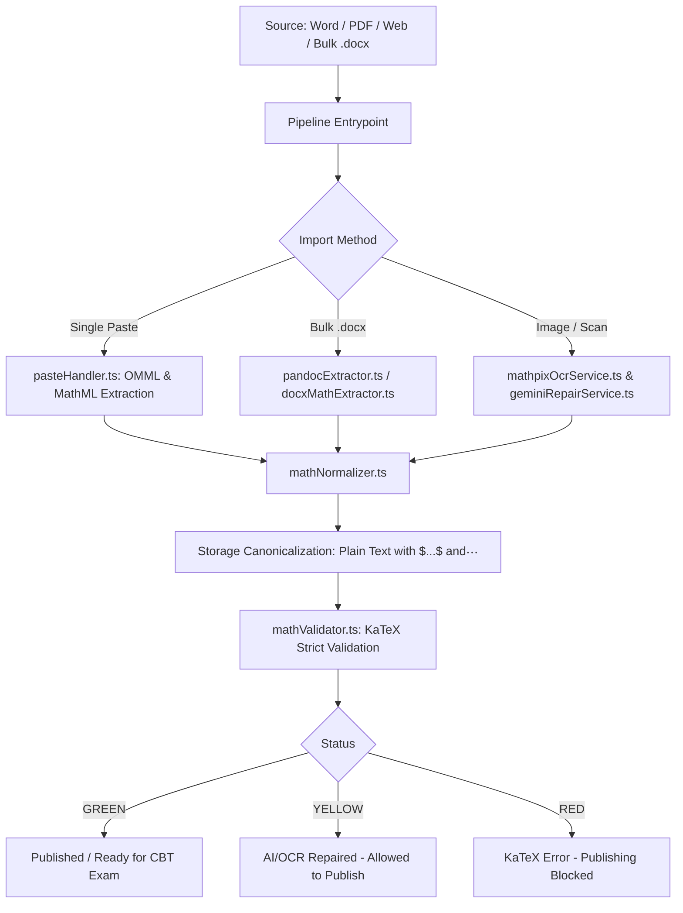

# DK Academy JEE — Math Import & Render System

## 1. System Architecture & 6-Stage Pipeline

The DK Academy Math Import & Render System guarantees that whatever faculty or administrators copy from Microsoft Word, PDFs, web portals, or upload in bulk via `.docx` renders identically in KaTeX with **zero manual editing** for normal JEE Main/Advanced and BITSAT test series.



### The 6-Stage Pipeline (Executed in Strict Order)

1. **Clipboard Ingestion (`pasteHandler.ts`)**:
   - Priority 1: Reads `text/html` looking for Word equation conditional comments `<!--[if gte msEquation 12]>...<m:oMath>...<![endif]-->`.
   - Strips Word fallback plain-text wrappers `<![if !msEquation]>...<![endif]>`.
   - Priority 2: Converts MathML `<math>` nodes into LaTeX syntax.
   - Priority 3: Extracts web KaTeX `<annotation encoding="application/x-tex">` and image alternative text (`img[alt]`).
   - Converts `<sup>` and `<sub>` tags to `^{...}` and `_{...}`.
   - Guard: `pasteContentGuard.ts` ensures no false content dropping banners when OMML compiles into unified expressions.

2. **Bulk `.docx` Import (`pandocExtractor.ts` & `docxMathExtractor.ts`)**:
   - Server-side execution using Pandoc:
     ```bash
     pandoc -f docx -t markdown+tex_math_dollars --wrap=none --extract-media=./media
     ```
   - Pure-Node fallback: If Pandoc is not installed on the server, `docxMathExtractor.ts` unpacks `word/document.xml` using `jszip` and `@xmldom/xmldom`, transforming OMML (`<m:oMath>`) directly to LaTeX.
   - Automatic section splitting: Detects Question numbers (e.g. `Q1.`, `1.`, `(1)`), options `(A)`, `(B)`, `(C)`, `(D)`, correct answer keys, marks, subjects, and topic tags.

3. **OCR Fallback (`mathpixOcrService.ts`)**:
   - Fallback for scanned test papers and phone snapshots.
   - Calls Mathpix API with strict formats: `['text', 'data']` and math delimiters `['$', '$']` / `['$$', '$$']`.
   - Converts image equations directly into LaTeX.

4. **Normalization & Canonicalization (`mathNormalizer.ts`)**:
   - Strips Word junk: non-breaking spaces (`\u00A0`), zero-width spaces (`\u200B`), smart quotes (`“”‘’`), and MSO box artifacts (`□`, `▒`).
   - Translates Unicode math: `−` $\to$ `-`, `°` $\to$ `^\circ`, `×` $\to$ `\times`, `÷` $\to$ `\div`, `≤` $\to$ `\le`, `≥` $\to$ `\ge`, `≠` $\to$ `\ne`.
   - Converts Word mathematical italics: `𝑥`, `𝑦`, `𝑧` $\to$ `x`, `y`, `z`.
   - Fixes Word thin-space residue: strips stray backslash-commas (`\,`) outside math so clauses remain intact.
   - Repairs linear equation residues:
     - `dy/(" " \, dx)` $\to$ `\dfrac{dy}{dx}`
     - `(A)/(B)^{3/2}` $\to$ `\dfrac{A}{(B)^{3/2}}`
     - Auto-balances and repairs missing braces in `\exp{...}` before prose boundaries.
   - Wraps bare LaTeX in canonical `$ ... $` leaving English words strictly outside.

5. **KaTeX Strict Validation & Publishing Guard (`mathValidator.ts`)**:
   - Validates all math expressions using KaTeX with custom macros (`\R`, `\N`, `\Z`, `\Q`, `\C`, `\d`, `\diff`, `\ihat`, `\jhat`, `\khat`, `\degree`).
   - Assigns a color-coded status:
     - **GREEN**: 100% syntactically valid KaTeX.
     - **YELLOW**: AI-repaired or OCR-sourced (valid syntax, admin review advised).
     - **RED**: KaTeX parsing error, unbalanced delimiters, empty fractions, or unresolved `[CHECK: ...]` markers.
   - **Publishing Rule**: Test series with **any RED questions are strictly blocked from publishing** at the backend controller level (`HTTP 400 PUBLISH_BLOCKED_RED_ITEMS`).

6. **Unified Client Rendering (`renderMath.ts`)**:
   - Single authoritative rendering function used across Admin Preview, Question Builder, and Student CBT Test-Taking views.
   - Escapes HTML entities safely via `element.textContent = text` to guarantee `< > &` never break KaTeX rendering.
   - Renders with `throwOnError: false` and formats `.katex-error` nodes into clean, non-intrusive inline chips.

---

## 2. Canonical Database Storage Rule

> [!IMPORTANT]
> **One Canonical Format Rule**:
> 1. Questions are stored strictly as plain text with `$ ... $` (inline math) and `$$ ... $$` (display math).
> 2. **Never** store rendered HTML (such as `<span class="katex">...</span>`).
> 3. **Never** store double-escaped backslashes (such as `\\frac`). Always normalize to single backslash `\frac`.
> 4. Normalization is enforced automatically on save and load in `testSeriesController.ts`.

---

## 3. Server Dependencies & Configuration

### A. Pandoc Installation

Pandoc provides the fastest and most accurate Word `.docx` to LaTeX conversion.

- **Windows**:
  ```powershell
  winget install JohnMacFarlane.Pandoc
  ```
  *(Restart terminal after installation to refresh the `PATH` variable).*
- **Ubuntu / Debian**:
  ```bash
  sudo apt-get update && sudo apt-get install -y pandoc
  ```
- **macOS**:
  ```bash
  brew install pandoc
  ```
- **Pure-Node Fallback**:
  If Pandoc is not installed or unavailable in the host environment, the system automatically switches to the built-in pure-Node XML extractor (`docxMathExtractor.ts`). No server crash occurs.

### B. Environment Variables (`backend/.env`)

Add the following credentials to enable OCR and AI repair:

```env
# Google Gemini API (for AI LaTeX Repair & Question Formatting)
GEMINI_API_KEY=your_gemini_api_key_here
GEMINI_MODEL=gemini-2.5-flash

# Mathpix API (Optional - for image / snapshot OCR fallback)
MATHPIX_APP_ID=your_mathpix_app_id
MATHPIX_APP_KEY=your_mathpix_app_key
```

---

## 4. REST API Reference (`/api/math-import`)

| Method | Endpoint | Description | Auth Required |
|---|---|---|---|
| `POST` | `/api/math-import/bulk-docx` | Upload `.docx` file (multipart form) and extract parsed question array | Admin / SuperAdmin |
| `POST` | `/api/math-import/bulk-markdown` | Ingest raw Markdown text with math dollars and parse into questions | Admin / SuperAdmin |
| `POST` | `/api/math-import/ocr` | Upload question image / scan for Mathpix OCR extraction | Admin / SuperAdmin |
| `POST` | `/api/math-import/ai-repair` | Submit broken question for Gemini 2.5 Flash LaTeX repair | Admin / SuperAdmin |
| `POST` | `/api/math-import/validate` | Validate question statement and options against KaTeX engine | Public / Admin |
| `POST` | `/api/math-import/normalize` | Normalize raw text into canonical KaTeX math format | Public / Admin |

---

## 5. Verification & Test Suite

The system includes a 113-test automated test suite covering all JEE subject areas:
- Differential Equations (including the 4 laptop photo questions)
- Limits (one-sided, trig, indeterminate, Riemann sums)
- Integrals (definite, indefinite, symmetry, partial fractions)
- Matrices & Determinants (pmatrix, vmatrix, bmatrix, adjoint, trace)
- Piecewise Cases environments
- Vectors & 3D Geometry (scalar triple product, symmetric lines)
- Chemistry Equations & Physics Units
- Word Clipboard Junk & Unicode conversions
- Storage Rule Enforcement
- Validation Status & Publishing Gate

Run the test suite:
```powershell
powershell -Command "cd backend; node --import tsx --test tests/mathImportRenderSystem.test.ts"
```
**Test Result**: 113/113 passed, 0 failed, 0 skipped.

